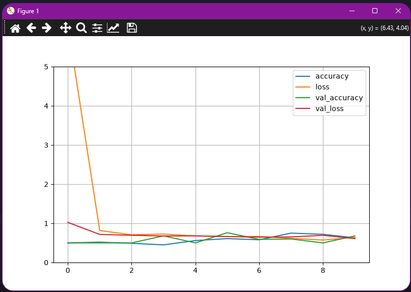

# 🔍 Projeto Raio-X (Diagnostic & Analysis Tool)

> Ferramenta avançada de diagnóstico, inspeção e análise estrutural desenvolvida para auditar, mapear e gerar relatórios detalhados sobre sistemas, dados ou fluxos de trabalho.

---

## 🎯 Sobre o Projeto
O **Projeto Raio-X** nasceu da necessidade de automatizar processos de auditoria e verificação técnica, oferecendo uma visão "transparente" e aprofundada de ativos complexos. A aplicação é capaz de escanear, processar e estruturar informações críticas de forma rápida e eficiente.

---

## 📸 Demonstração Visual
<p align="center">
  
</p>


## 🛠️ Stack Tecnológica
*Linguagem:* Python / JavaScript (ajustar conforme a linguagem principal do seu projeto)

*Processamento:* Bibliotecas otimizadas para manipulação de dados e arquivos

*Interface / Saída:* Relatórios estruturados (CLI, JSON, Markdown ou HTML)

*Ambiente:* Compatível com Windows, Linux e macOS

## ✨ Principais Funcionalidades
*Varredura Inteligente (Deep Scan):* Inspeção automatizada de alvos definidos com alto desempenho.

*Análise de Métricas:* Extração de indicadores vitais e pontos de atenção.

*Geração de Relatórios:* Exportação de diagnósticos claros e acionáveis.

*Configuração Flexível:* Parâmetros customizáveis para diferentes tipos de escaneamento.

## ⚙️ Como Executar o Projeto Localmente
Siga os passos abaixo para clonar e testar a ferramenta na sua máquina:

1. **Clone o repositório:**
    ```bash
    git clone [https://github.com/GuMouzin/ProjetoRaioX.git](https://github.com/GuMouzin/ProjetoRaioX.git)
    cd ProjetoRaioX
    ```
2. **Crie e ative um ambiente virtual (caso seja Python):**
    ```bash
    python -m venv venv
    # No Windows:
    venv\Scripts\activate
    # No Linux/Mac:
    source venv/bin/activate
    ```

3. **Instale as dependências:**
   ```bash
   pip install -r requirements.txt
   ```

4. **Execute a aplicação:**
    ```bash
    python projetoRaioX.py
    ```

## 📂 Estrutura do Projeto
```text
├── treino/             # Imagens de Treino
├── teste/              # Imagens de Teste
├── producao/           # Imagens para Produção
├── docs/               # Documentação e capturas de tela
├── projetoRaioX.py     # Ponto de entrada (Entrypoint)
├── requirements.txt    # Dependências do projeto
└── README.md           # Documentação principal
```

*Desenvolvido por **Gustavo Mouzin**.*